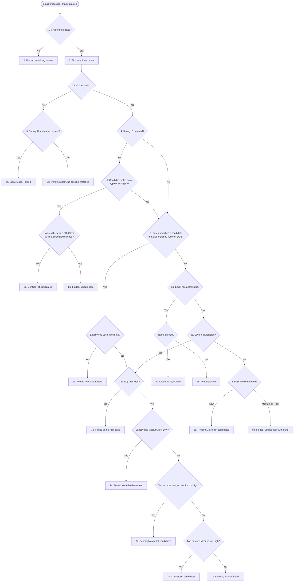

# Email matching rules

Rules for matching an extracted child to existing cases. Each step in the flow below is labelled with its rule ID. Example IDs refer to `tests/Ehcp.Specs/Features/GetEmail.feature`.

Statuses: **Folded** (linked to a case), **Conflict** (candidates listed, conflict recorded), **PendingMatch** (no link, candidates listed where there are any).

Score bands: **Low** below 10, **Medium** 10 to 19, **High** 20 and above.

## Rules

1. **Children extracted? No:** discard the email and log the reason.
2. **Find candidates:** cases matching on name, DOB, parent or a strong ID.
   Strong IDs are NHS number, case ID, Mosaic, DfE and Synergy. DOB is a scored attribute, not a strong ID.
3. **No candidates:**
   - 3a. Strong ID and name present: create a case, Folded, no possible matches.
   - 3b. Otherwise: PendingMatch, no possible matches.
4. **Candidates found:** if the email has a strong ID, go to step 5. Otherwise go to step 6.
5. **Strong ID on the email:**
   - 5a. A candidate holds a strong ID of the same type with a different value, or the DOB differs while a strong ID matches: Conflict, list candidates, add conflict.
   - 5b. A strong ID matches a candidate with no conflict: Folded, update the case.
   - 5c. The strong ID matches no candidate and step 6 does not fold: if the name is present, create a case, Folded, no possible matches. Otherwise PendingMatch.
6. **Parent match:** a parent (name or email) matches a candidate that also matches on name or DOB.
   - 6a. Exactly one such candidate: Folded, update the case.
   - 6b. More than one: go to step 7.
   - 6c. No parent match: go to step 7 if there are several candidates, otherwise step 8.
7. **Several candidates:**
   - 7a. Exactly one High: Folded, update the case.
   - 7b. Two or more Low, no Medium or High: PendingMatch, list candidates.
   - 7c. Two or more Medium, no High: Conflict, list candidates, add conflict.
   - 7d. One Medium with the rest Low: Folded to the Medium case.
   - 7e. Any other combination (two or more High, or High with Medium): Conflict, list candidates, add conflict.
8. **Single candidate, or best candidate after step 7:**
   - 8a. Low: PendingMatch, list candidates.
   - 8b. Medium or High: Folded, update the case with the band.

## Flow

## Coverage

| Rule | Examples |
|---|---|
| 1 | Scenarios "Email with no child information is discarded with a rationale" and "An out-of-office reply is discarded with its rationale" |
| 3a | spec-c-1, spec-c-2, spec-c-3 (creation outline) |
| 3b | spec-f-no-evidence, spec-f-different-name-different-dob, scenario "Email with child information extracted but not enough to create a case" |
| 5a | spec-s-nhs-conflict, spec-s-dfe-conflict, spec-s-mosaic-conflict, spec-s-synergy-attribute-conflict, spec-s-synergy-field-conflict, spec-s-competing-ids, spec-s-same-case-two-ids, spec-s-competing-dob-ids, spec-s-exact-name-wrong-dob, spec-s-exact-name-competing-ids, spec-l-diff-nhs, spec-l-diff-mosaic, spec-l-diff-dfe, spec-l-diff-synergy, spec-l-diff-caseid, spec-l-diff-nhs-parent, spec-i-nhs-synergy-differs, spec-i-nhs-dfe-differs, spec-i-nhs-mosaic-differs, spec-i-dfe-nhs-differs, spec-i-caseid-nhs-differs, spec-i-mosaic-nhs-differs, spec-i-nhs-dob-differs, spec-i-nhs-two-ids-differ, spec-i-ids-two-cases |
| 5b | spec-s-nhs-fold, spec-s-dfe-fold, spec-s-mosaic-fold, spec-s-synergy-attribute-fold, spec-s-synergy-field-fold, spec-s-nhs-jones-fold, spec-s-dfe-jones-fold, spec-i-missing-id-folds |
| 5c | **Not covered** |
| 6a | spec-l-name-parent-email, spec-l-name-parent-name, spec-l-name-parent-only, spec-l-name-initials-parent, spec-l-dob-parent-email, spec-l-dob-parent-name |
| 6b | **Not covered** |
| 6c | spec-l-name-other-parent, spec-l-dob-other-name, spec-l-dob-no-name |
| 7a | **Not covered** |
| 7b | spec-f-other-name-dob, spec-f-dob-only |
| 7c | **Not covered** |
| 7d | scenario-5-fuzzy-name-possible-matches, spec-f-fredd-dob, spec-f-fred-dob, spec-f-frederick-dob, spec-f-jones-dob, spec-f-fred-initial-dob, spec-f-jones-initial-dob, spec-f-exact-fred-dob, spec-f-exact-jones-dob, spec-f-full-lowercase-dob, spec-f-different-surname-dob, spec-f-fuzzy-first-name-dob |
| 7e | **Not covered** |
| 8a | spec-f-fuzzy-name-only, spec-f-fredd-name-only, spec-f-jones-name-only, spec-f-full-name-only, spec-f-jones-full-only, spec-f-different-dob, spec-f-full-lowercase-only, spec-l-name-other-parent, spec-l-dob-other-name, spec-l-dob-no-name |
| 8b | **Not covered directly.** Medium cases in scenario 5 fold through 7d. |

Rules 2 and 4 are routing steps and are exercised by every example that reaches them.

## Open points

- **5c:** no example. The flow reads step 6 as checked first, so the create happens only when no parent fold applies.
- **6b, 7a, 7c:** no example.
- **7e:** not stated in the rule list. It follows from the answer "any other goes to conflict or pending". The answer names no route for two or more High or High with Medium, so 7e uses Conflict.
- **8b:** no example with a single Medium or High candidate.
